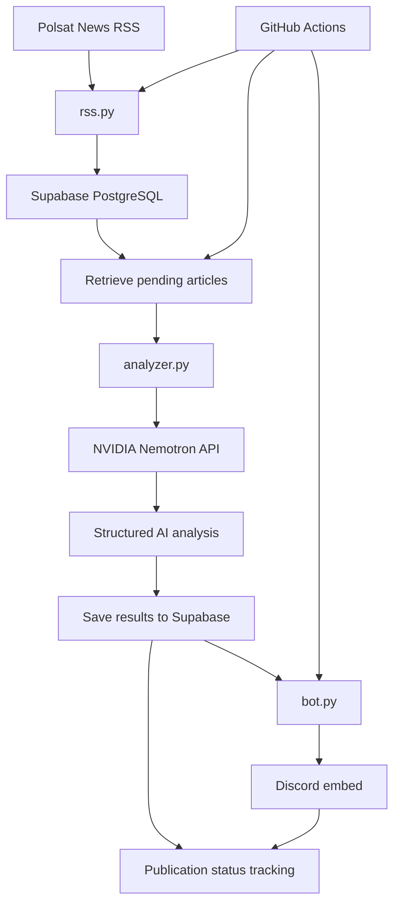

<div align="center">

# RSS Agent AI

### From raw news feeds to structured, AI-powered insights.

An automated RSS monitoring agent that collects news, analyzes its content
with NVIDIA Nemotron, stores structured results in Supabase, and delivers
enriched notifications to Discord.

<br>


[](https://github.com/Yorick0499/feed-agent-ai/actions/workflows/rss-bot.yml)


<br>

**[Repository](https://github.com/Yorick0499/feed-agent-ai)**

</div>

---

## Overview

**RSS Agent AI** is a Python-based automation project that transforms
RSS news feeds into structured, AI-enriched data and delivers the results
directly to Discord.

Instead of simply forwarding headlines, the agent uses an LLM to generate
concise summaries, categorize articles, identify their sentiment, and
estimate their clickbait and sensationalism levels.

Supabase provides persistent storage, while GitHub Actions automates
the execution process without requiring a continuously running machine.

The project currently uses the Polsat News RSS feed as its news source.

## Key Features

- **Automated RSS ingestion** — fetches and parses news articles from Polsat News.
- **AI-powered analysis** — uses NVIDIA Nemotron to analyze article titles and descriptions.
- **Automatic summarization** — generates concise, neutral summaries in Polish.
- **Topic classification** — assigns a primary category to each article.
- **Sentiment analysis** — classifies the article's tone as positive, negative, neutral, or mixed.
- **Clickbait estimation** — evaluates potentially misleading or curiosity-driven headlines.
- **Sensationalism estimation** — estimates the degree of dramatic or emotionally exaggerated language.
- **Persistent storage** — stores articles and analysis results in Supabase PostgreSQL.
- **Duplicate prevention** — uses a content-derived hash to identify previously collected articles.
- **Discord integration** — publishes enriched articles using formatted Discord embeds.
- **Scheduled execution** — runs automatically through GitHub Actions.
- **Resumable processing** — tracks analysis and publication status to allow pending work to be retried.

## How It Works



### Processing Pipeline

1. **Fetch:** retrieve the RSS feed and parse article metadata.
2. **Deduplicate:** generate a hash from the article's title, description,
   link, and publication date.
3. **Persist:** save new articles to Supabase.
4. **Analyze:** retrieve articles awaiting analysis and send their titles
   and descriptions to NVIDIA Nemotron.
5. **Store results:** save the generated summary, category, sentiment,
   scores, confidence, and reasoning.
6. **Publish:** send analyzed articles to Discord as formatted embeds.
7. **Track status:** record successful publication to prevent articles from
   being repeatedly published during normal operation.

Processing and publication state is stored remotely, allowing subsequent
executions to continue working with pending articles.

## AI Analysis

RSS Agent AI uses the NVIDIA-hosted model:

`nvidia/nemotron-3-ultra-550b-a55b`

The model receives an article's title and description and returns structured
JSON containing the following fields:

| Field | Description |
|---|---|
| `summary` | A concise summary in Polish |
| `topic` | The primary topic or category |
| `sentiment` | Positive, negative, neutral, or mixed |
| `clickbait_score` | Estimated clickbait intensity, from 0 to 100 |
| `sensationalism_score` | Estimated sensationalism, from 0 to 100 |
| `confidence` | The model's confidence in its analysis, from 0 to 1 |
| `reasoning` | A short explanation of the assessment |

The analysis prompt instructs the model to use only the supplied title
and description, avoid inventing facts, and distinguish sensational
news topics from sensationalistic writing.

**Important:** these scores are model-generated estimates, not objective
measurements or verified judgments about the truthfulness of an article.
The model does not independently fact-check the source.

## Technology Stack

| Technology | Purpose |
|---|---|
| Python 3.12 | Core application logic |
| `requests` | HTTP requests to the RSS source |
| `xml.etree.ElementTree` | RSS/XML parsing |
| `discord.py` | Discord bot and message delivery |
| NVIDIA Nemotron API | AI-powered article analysis |
| OpenAI Python SDK | OpenAI-compatible API integration |
| Supabase | Hosted PostgreSQL database and persistent storage |
| `python-dotenv` | Local environment configuration |
| GitHub Actions | Scheduled execution and automation |

## Project Structure

```text
feed-agent-ai/
├── .github/
│   └── workflows/
│       └── rss-bot.yml
├── analyzer.py
├── bot.py
├── database.py
├── rss.py
├── requirements.txt
├── .gitignore
└── README.md
```

| File | Responsibility |
|---|---|
| `bot.py` | Coordinates analysis, publication, and Discord integration |
| `rss.py` | Fetches and parses the RSS feed |
| `analyzer.py` | Sends article data to NVIDIA Nemotron and validates its response |
| `database.py` | Handles Supabase operations and article processing state |
| `requirements.txt` | Defines Python dependencies |
| `.github/workflows/rss-bot.yml` | Configures automated execution |

## Getting Started

### Prerequisites

Before running the project, make sure you have:

- Python 3.12 or compatible Python 3.x environment
- A Discord application and bot token
- A Discord channel where the bot can publish messages
- An NVIDIA API key with access to the configured model
- A Supabase project

### 1. Clone the Repository

```bash
git clone https://github.com/Yorick0499/feed-agent-ai.git
cd feed-agent-ai
```

### 2. Create a Virtual Environment

```bash
python3.12 -m venv .venv
source .venv/bin/activate
```

On Windows, activate the environment with:

```powershell
.venv\Scripts\Activate.ps1
```

### 3. Install Dependencies

```bash
python -m pip install -r requirements.txt
```

### 4. Configure Environment Variables

Create a `.env` file in the project root:

```dotenv
DISCORD_TOKEN=your_discord_bot_token
NVIDIA_API_KEY=your_nvidia_api_key
SUPABASE_URL=https://your-project.supabase.co
SUPABASE_KEY=your_server_side_supabase_key
```

Replace the example values with your own credentials.

The Supabase key must be suitable for trusted server-side operations.
Never expose a secret or legacy `service_role` key in client-side code
or commit it to the repository.

Make sure `.env` is included in `.gitignore`.

### 5. Configure Supabase

Create an `articles` table in the Supabase SQL Editor:

```sql
CREATE TABLE public.articles (
    hash_id TEXT PRIMARY KEY,
    title TEXT NOT NULL,
    description TEXT NOT NULL DEFAULT '',
    link TEXT NOT NULL DEFAULT '',
    pub_date TEXT,

    summary TEXT,
    topic TEXT,
    sentiment TEXT,
    clickbait_score INTEGER CHECK (
        clickbait_score BETWEEN 0 AND 100
    ),
    sensationalism_score INTEGER CHECK (
        sensationalism_score BETWEEN 0 AND 100
    ),
    confidence DOUBLE PRECISION CHECK (
        confidence BETWEEN 0 AND 1
    ),
    reasoning TEXT,

    analyzed_at TIMESTAMPTZ,
    discord_posted_at TIMESTAMPTZ,
    created_at TIMESTAMPTZ NOT NULL DEFAULT NOW()
);

ALTER TABLE public.articles ENABLE ROW LEVEL SECURITY;
```

The table stores the original article data, its AI-generated analysis,
and processing timestamps.

The application uses Supabase's Python client to access the table.

### 6. Configure Discord

Create a Discord application in the
[Discord Developer Portal](https://discord.com/developers/applications)
and configure its bot.

Invite the bot to your server and grant it the permissions required
to access the target channel and send messages with embeds.

Set the target channel ID in `bot.py`:

```python
CHANNEL_ID = 123456789012345678
```

Replace the example ID with your actual Discord channel ID.

### 7. Run Locally

Start the agent:

```bash
python bot.py
```

The application executes a single processing cycle:

- Fetches the RSS feed.
- Saves newly discovered articles.
- Analyzes pending articles.
- Publishes analyzed articles to Discord.
- Updates processing status in Supabase.

The process exits after the cycle finishes rather than running continuously.

## Automated Execution

RSS Agent AI uses GitHub Actions to run the application periodically.

The workflow is defined in:

`.github/workflows/rss-bot.yml`

The current schedule is:

```yaml
on:
  schedule:
    - cron: "17 * * * *"
  workflow_dispatch:
```

The scheduled workflow runs hourly at minute 17 in UTC.
GitHub Actions may occasionally delay scheduled executions.

The `workflow_dispatch` trigger also allows manual execution from the
GitHub Actions interface.

### Configure GitHub Secrets

To enable remote execution, add the following repository secrets under:

**Settings → Secrets and variables → Actions**

| Secret | Description |
|---|---|
| `DISCORD_TOKEN` | Discord bot token |
| `NVIDIA_API_KEY` | NVIDIA API key |
| `SUPABASE_URL` | Supabase project URL |
| `SUPABASE_KEY` | Server-side Supabase key |

The workflow passes these secrets to the Python process as environment
variables. The `.env` file is not required in the GitHub Actions environment.

## Data Storage

Each article is identified by a hash generated from its title, description,
link, and publication date.

The Supabase table separates the article's content from its processing
state.

| Column | Purpose |
|---|---|
| `hash_id` | Unique article identifier |
| `title` | Original headline |
| `description` | RSS article description |
| `link` | Original article URL |
| `pub_date` | Publication date supplied by the feed |
| `summary` | AI-generated summary |
| `topic` | Assigned topic |
| `sentiment` | Estimated sentiment |
| `clickbait_score` | Clickbait score |
| `sensationalism_score` | Sensationalism score |
| `confidence` | Model confidence |
| `reasoning` | Explanation of the analysis |
| `analyzed_at` | Time the analysis was saved |
| `discord_posted_at` | Time successful publication was recorded |
| `created_at` | Database record creation time |

The processing timestamps help the agent distinguish between articles
that still require analysis and articles that have been analyzed but
not yet published.

## Security and Reliability

The project follows several basic security and reliability practices:

- API keys and bot tokens are supplied through environment variables.
- `.env` is excluded from version control.
- Supabase stores processing state between executions.
- Article hashes help prevent duplicate records.
- AI responses are parsed and validated before their results are stored.
- Failed analysis or publication attempts can be retried in a subsequent cycle.

There are still limitations to consider:

- AI-generated assessments may be inaccurate or inconsistent.
- External API availability and rate limits can affect execution.
- Discord publication and the corresponding database update are separate
  operations, so an ambiguous network failure can result in a duplicate message.
- Concurrent workflow executions are not protected by a distributed locking
  mechanism.
- The current article identity is based on selected RSS fields; changes to
  those fields may produce a new hash.


## Acknowledgements

RSS Agent AI builds on the following services and technologies:

- [Polsat News](https://www.polsatnews.pl/) — RSS news source
- [NVIDIA](https://build.nvidia.com/) — hosted Nemotron model
- [Supabase](https://supabase.com/) — database and backend infrastructure
- [Discord](https://discord.com/) — notification platform
- [GitHub Actions](https://github.com/features/actions) — workflow automation

---

<div align="center">

**RSS Agent AI**  
Automated news collection. Structured AI analysis. Actionable notifications.

</div>
